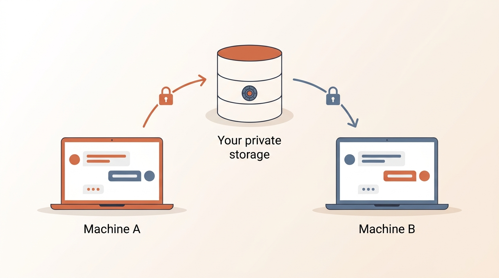
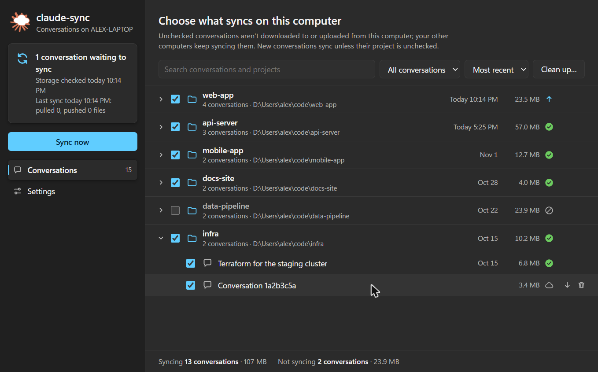
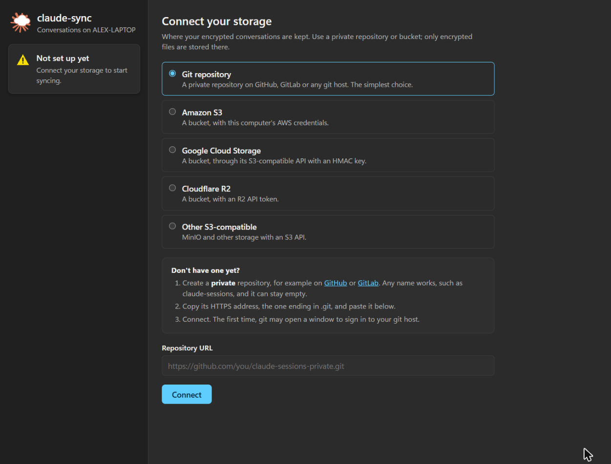
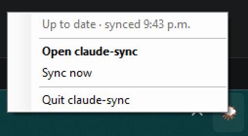
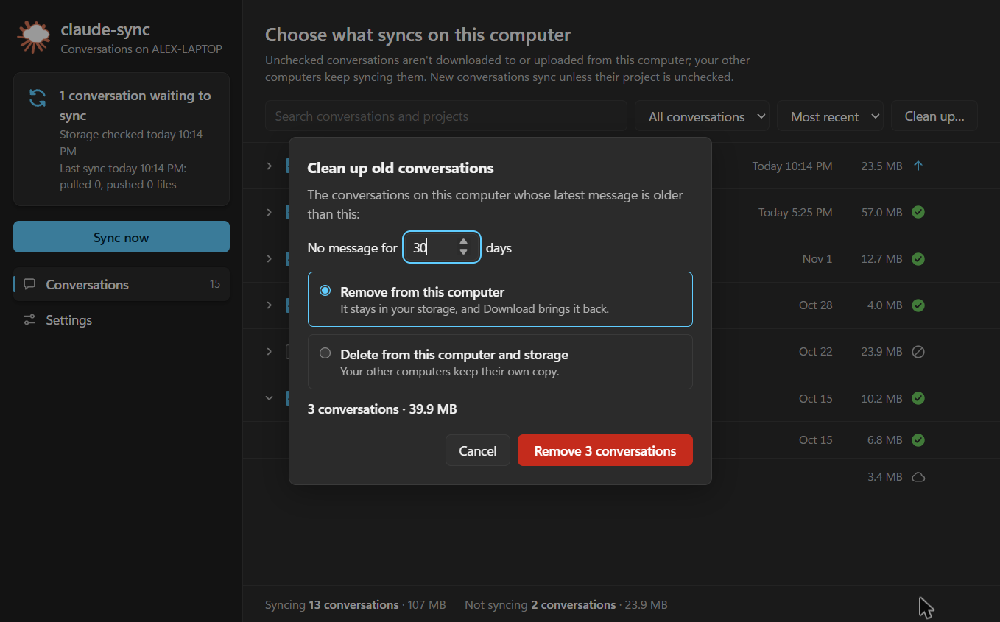
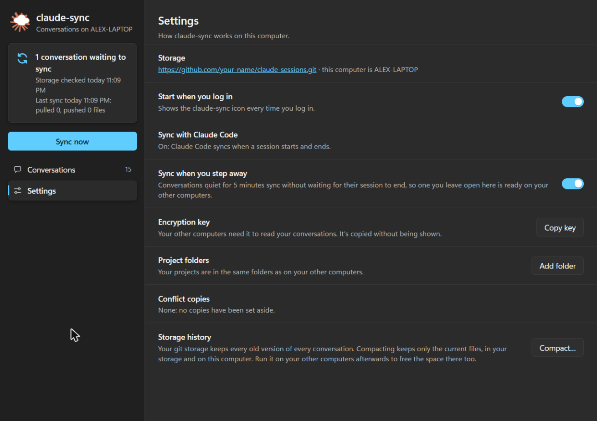

# claude-sync

Sync Claude Code conversations across machines. E2E encrypted, privacy-first.


[](https://github.com/chronicideas/claude-sync/actions/workflows/ci.yml)

> **Disclaimer:** This is an independent, community-built tool. It is **not affiliated with, endorsed by, or supported by Anthropic**. Use of Claude Code is subject to [Anthropic's Terms of Service](https://www.anthropic.com/policies/consumer-terms). This tool syncs conversation data that may contain sensitive information—ensure compliance with your organization's data policies before use.

## The Problem

Claude Code stores conversations locally. When you switch machines, your conversation history doesn't follow you.

## The Solution

`claude-sync` automatically syncs your Claude Code sessions to your own storage (Git, S3, GCS, R2), encrypted with a key only you control.

- **End-to-end encrypted** - AES-256-GCM encryption before data leaves your machine
- **Your storage** - Use your own private Git repo, AWS S3, Google Cloud Storage, Cloudflare R2, or any S3-compatible service
- **Zero trust** - We never see your conversations or encryption keys
- **Automatic** - Hooks into Claude Code's session lifecycle
- **Incremental** - Only files changed since the last sync are uploaded
- **Desktop app or terminal** - A notification area icon and a dashboard on Windows, macOS and Linux, or just the command line

## How It Works



Before anything leaves a machine, claude-sync encrypts it with your key, and it decrypts what it downloads, so your storage (Git, S3, GCS or R2) only ever holds encrypted files. Every sync pulls the other machines' changes first, then pushes this machine's, so it works the same in both directions.

Claude Code's hooks run a sync when a session starts and when it ends, and `/resume` on the other machine picks the conversation up. With the desktop app, [the icon](#the-icon) also syncs conversations left open, and whenever you click **Sync now**. The [details](#sync-details) cover what gets synced and how conflicts are settled.

## Quick Start

You need [Node.js](https://nodejs.org) 18 or later, and [Git](https://git-scm.com) to keep your sessions in a Git repository.

### With the desktop app

The easiest way to start. Download this repository (**Code → Download ZIP**, or `git clone`) and double-click the installer for your system:

| Windows | macOS | Linux |
|---------|-------|-------|
| `install-windows.cmd` | `install-macos.command` | `./install-linux.sh` |

It installs claude-sync, turns on syncing with Claude Code, adds the [icon](#the-icon) and opens the [dashboard](#desktop-app) to connect your storage, with steps for creating one. From then on your conversations sync on their own.

The first time, your system may warn about a script from the internet: on Windows choose **More info → Run anyway**, on macOS allow it in **System Settings → Privacy & Security**.

Or with npm, then click the icon to connect your storage:

```bash
npm install -g @chronicideas/claude-sync
claude-sync install --tray
```

### In the terminal

For a server, a machine without a desktop, or if you'd rather not have the icon:

```bash
# Install
npm install -g @chronicideas/claude-sync

# Initialize with your storage backend
claude-sync init --git https://github.com/yourusername/claude-sessions-private
# or
claude-sync init --s3 my-bucket --region us-west-2
# or
claude-sync init --gcs my-gcs-bucket
# or
claude-sync init --r2 my-r2-bucket

# Install Claude Code hooks
claude-sync install --global

# Done! Sessions will sync automatically
```

Both work the same underneath, so you can add the icon later with `claude-sync install --tray`.

## Desktop App

An icon in the notification area (the menu bar on macOS) shows when a sync runs, and a dashboard lets you connect your storage, choose which conversations sync on each machine, clean up old ones and change settings, without the terminal. It runs on **Windows, macOS and Linux** with nothing to install beyond claude-sync: PowerShell draws the icon on Windows, `osascript` on macOS and `python3` on Linux. It's optional: the hooks keep syncing whether the icon runs or not.



### Connect your storage



The first time, the dashboard sets claude-sync up, like `claude-sync init` does in the terminal:

- **Storage**: a private Git repository or a bucket, with short steps for creating one
- **Encryption key**: made for you on your first machine, to keep somewhere safe. Your other machines ask for it, and **Copy key** in Settings copies it
- **Project folders**: where your projects are, if your machines keep them in different places
- **Finish**: turns on syncing with Claude Code, and the icon if you want it, then syncs

### The icon



It shows how things stand at a glance, including the syncs Claude Code runs when a session starts or ends:


Click it to open the dashboard; its menu has the status, **Sync now** and **Quit**. It also syncs a conversation you leave open once it has been quiet for 5 minutes, so walking away from one computer without closing Claude Code doesn't keep it from your others.

### Choose what syncs

Every project and conversation on this machine or in your storage is listed with its latest message, size and state: up to date, waiting to upload or download, only in storage, or not syncing here.

- Uncheck a conversation, or a whole project, to keep it off this machine. Your other machines keep syncing it.
- New conversations sync unless their project is unchecked.
- A conversation that's only in storage, for example one Claude Code cleaned up after 30 days, has a **Download** button.

### Clean up



Delete one conversation from its row, or every conversation with no message for a number of days, in one of two ways:

- **Remove from this computer** frees the space here. The conversation stays in your storage, and **Download** brings it back.
- **Delete from this computer and storage** removes it from both. Your other machines keep their own copy.

### Settings



Besides starting at login and syncing when you step away:

- **Sync with Claude Code** checks that the hooks are installed and still work, with **Repair** if not
- **Encryption key** copies the key for your other machine, without showing it
- **Project folders** sets up [folder mappings](#restoring-into-the-right-project)
- **Conflict copies** opens the copies set aside when two machines changed the same file
- **Storage history** (Git): a Git repository keeps every version ever pushed. That's a safety net for a conversation deleted or overwritten by mistake, but it grows with each sync, so choose how long old versions stay: 1, 3, 7 (the default) or 30 days, or forever. It's one setting for all your machines, and the icon drops older versions about once a day; **Compact** drops them all now.

### Good to know

- The dashboard is served on `127.0.0.1` only, behind a one-time link, so other websites and other users can't reach it. It opens in a window of its own when Chrome, Edge, Chromium or Brave is installed.
- On Linux the icon needs GTK and Ayatana AppIndicator for `python3` (`sudo apt install gir1.2-ayatanaappindicator3-0.1` on Debian and Ubuntu); GNOME also needs the AppIndicator extension. macOS needs version 11 or later.
- On Windows 11 a new icon starts in the hidden overflow (^): drag it onto the taskbar to keep it in sight.
- `claude-sync dashboard` opens the dashboard without the icon, and `claude-sync tray --no-startup` stops the icon starting at login. Problems are logged to `~/.claude-sync/tray/tray.log`.

## Sync Details

### What gets synced

Everything Claude Code keeps per project under `~/.claude/projects/<project>/`: session transcripts, subagent transcripts, tool results and the project's memory folder. Each file is encrypted separately, and only files that changed since the last sync are uploaded.

### Restoring into the right project

Claude Code names each project folder after the project's absolute path (`C:\Users\me\code\app` → `C--Users-me-code-app`), and `/resume` only lists sessions from the folder that matches your current directory. claude-sync stores the home-directory part as `@home` (`@home-code-app`) and expands it with the local home directory when pulling, so a project kept at the same place relative to your home directory lands in the right folder on every machine, even with a different username or OS.

If one machine keeps its projects somewhere else, map the folder on that machine:

```bash
claude-sync folder add ~/Workspace D:\Projects
```

Projects in `D:\Projects` are then stored as if they were in `~/Workspace`, so `D:\Projects\app` on this machine and `~/Workspace/app` on the others share their sessions. Add the mapping before the first sync: sessions already synced from the old location aren't moved.

### Conflicts

Every sync pulls before it pushes, so a push never silently overwrites another machine's work:

- If one copy of a transcript extends the other (the normal case), the longer one wins.
- If only one side changed a file since the last sync, that side wins.
- If both copies of a conversation moved on since they last matched, the one with the most recent message wins. This is what happens when you switch machines while Claude Code still has the conversation open on the first one, since it keeps writing a few bookkeeping lines to it. If the other copy has messages of its own (the conversation really did go on in both places), it's saved to `~/.claude-sync/conflicts/`.
- For any other file both sides changed, the local copy is kept and the other copy is saved to `~/.claude-sync/conflicts/`.
- A project's memory index (`memory/MEMORY.md`) is merged line by line instead, so memories added on both machines are all listed.

The session that is currently open is never overwritten by a hook, nor uploaded by one over a copy with a more recent message; it is reconciled on the next sync after it closes. Deletions are not synced, so Claude Code's cleanup of old transcripts on one machine doesn't remove them anywhere else.

## Commands

| Command | Description |
|---------|-------------|
| `claude-sync init` | Set up storage backend and encryption key (`--key <base64>` to reuse your other machine's) |
| `claude-sync install` | Add hooks to Claude Code for automatic sync (`--tray` also adds the icon, started at login) |
| `claude-sync sync` | Pull remote changes, then push local changes |
| `claude-sync push` | Same as `sync`: remote changes are always pulled first |
| `claude-sync pull` | Pull only (`--all` also restores files deleted locally) |
| `claude-sync status` | Show configuration and sync status |
| `claude-sync folder add <other> <here>` | Keep projects from `<other>` on your other machines (e.g. `~/Workspace`) in `<here>` on this one |
| `claude-sync folder remove <other>` | Undo `folder add` |
| `claude-sync key export` | Print the encryption key as base64 |
| `claude-sync key import <base64>` | Use an existing encryption key |
| `claude-sync dashboard` | Open the [dashboard](#desktop-app) in your browser |
| `claude-sync tray` | Show the [notification area icon](#the-icon) (`--startup` to start it at login) |

## Storage Backends

### Git

Use any private Git repository. GitHub, GitLab, Bitbucket, or self-hosted.

```bash
claude-sync init --git https://github.com/yourusername/claude-sessions-private
```

GitHub refuses files over 100 MB, so a transcript that big (usually one with many images) is skipped with a warning and stays on the machine it was written on. Use S3 or R2 if you need those synced too.

### AWS S3

```bash
claude-sync init --s3 my-bucket --region us-west-2

# Uses AWS credentials from environment or ~/.aws/credentials
```

### Google Cloud Storage

```bash
claude-sync init --gcs my-gcs-bucket

# Uses Cloud Storage's S3-compatible API: set an HMAC key (Settings > Interoperability)
# as AWS_ACCESS_KEY_ID and AWS_SECRET_ACCESS_KEY
```

### Cloudflare R2

```bash
claude-sync init --r2 my-bucket --endpoint https://ACCOUNT_ID.r2.cloudflarestorage.com

# Set AWS_ACCESS_KEY_ID and AWS_SECRET_ACCESS_KEY with R2 API tokens
```

### Other S3-Compatible (MinIO, etc.)

```bash
claude-sync init --s3 my-bucket --endpoint https://minio.example.com --region us-east-1
```

### Interactive Setup

Just run `claude-sync init` without flags for an interactive wizard that guides you through setup. When the storage already has synced sessions, it asks for the key they were encrypted with. The dashboard does the same in a window.

## Security

### Threat Model

**What claude-sync protects against:**

- **Storage provider reading your data** - Sessions are encrypted before leaving your machine. Your Git host, S3 provider, etc. cannot read the content.
- **Network interception** - Even if TLS were compromised, the payload is already encrypted.
- **Accidental plaintext exposure** - Every push validates data is encrypted before upload.

**What claude-sync does NOT protect against:**

- **Compromised local machine** - If an attacker has access to your machine, they can read `~/.claude-sync/key` and decrypt everything.
- **Key theft** - Anyone with your encryption key can decrypt all your sessions.
- **Metadata exposure** - Session IDs, file sizes, and sync timestamps are visible to your storage provider.
- **Memory attacks** - Decrypted data exists in memory during processing.
- **Weak storage credentials** - If your Git/S3/GCS credentials are compromised, attackers get encrypted blobs (safe) but could delete your data.

**Trust assumptions:**

- You trust your local machine's security
- You trust Node.js `crypto.randomBytes()` for key and IV generation
- You trust AES-256-GCM as implemented in Node.js/OpenSSL

### Cryptographic Details

| Component | Implementation |
|-----------|----------------|
| **Algorithm** | AES-256-GCM (authenticated encryption with associated data) |
| **Key** | 256-bit, generated via `crypto.randomBytes(32)` |
| **IV/Nonce** | 96-bit (12 bytes), unique per encryption via `crypto.randomBytes(12)` |
| **Auth Tag** | 128-bit (16 bytes), provides integrity and authenticity |
| **Format** | `IV (12 bytes) || AuthTag (16 bytes) || Ciphertext` |
| **Key Storage** | `~/.claude-sync/key` with mode `0600` (owner read/write only) |
| **Config Dir** | `~/.claude-sync/` with mode `0700` (owner only) |

**Security properties:**

- **Confidentiality** - AES-256 encryption prevents reading without the key
- **Integrity** - GCM auth tag detects any tampering with ciphertext
- **Authenticity** - Only someone with the key could have produced valid ciphertext
- **No nonce reuse** - Fresh random IV for every encryption operation

**Not implemented (potential future work):**

- Key rotation mechanism
- Key derivation from password (currently raw key only)
- Forward secrecy
- Audit logging

### Your Responsibilities

1. **Back up your key** - Without it, you cannot decrypt your sessions
2. **Use private storage** - The encrypted data is safe, but why expose it?
3. **Protect your machines** - Anyone with access to `~/.claude-sync/key` can decrypt
4. **Check your company policy** - Claude Code sessions may contain proprietary code, incident context, or customer info

### Key Backup

```bash
# Export your key (store this somewhere safe, e.g. a password manager)
claude-sync key export

# Import on another machine
claude-sync key import YOUR_BASE64_KEY
```

`claude-sync init` never replaces an existing key, since everything already pushed with it would become unreadable.

## How Claude Code Hooks Work

`claude-sync install` adds these hooks to your Claude Code settings, using absolute paths to `node` and the CLI so they work whatever `PATH` Claude Code runs them with:

```json
{
  "hooks": {
    "SessionStart": [{
      "hooks": [{
        "type": "command",
        "command": "\"/path/to/node\" \"/path/to/claude-sync/dist/cli.js\" sync --hook",
        "timeout": 120
      }]
    }],
    "SessionEnd": [{
      "hooks": [{
        "type": "command",
        "command": "\"/path/to/node\" \"/path/to/claude-sync/dist/cli.js\" sync --hook",
        "timeout": 120
      }]
    }]
  }
}
```

- **SessionStart**: Picks up work from your other machines (and pushes anything a previous session left behind)
- **SessionEnd**: Pushes the conversation you just finished

With `--hook`, claude-sync reads the session ID Claude Code passes on stdin, prints nothing to stdout (SessionStart output would be added to Claude's context), and never fails the session: errors go to stderr. Re-running `claude-sync install` replaces earlier claude-sync hooks and keeps your other hooks.

## Setting Up on a New Machine

1. Clone your projects to the same place relative to your home directory (e.g. `~/code/app`), or [map the folder](#restoring-into-the-right-project)
2. Get your encryption key from your existing machine: **Copy key** in the dashboard's Settings, or `claude-sync key export`
3. Set up claude-sync with the same storage and that key:
   - **Desktop app:** run the installer (or `claude-sync install --tray`) and connect the same storage in the dashboard, which then asks for the key
   - **Terminal:**
     ```bash
     npm install -g @chronicideas/claude-sync
     claude-sync init --git <same-repo> --key <base64-key>
     claude-sync sync              # pull existing sessions
     claude-sync install --global  # install hooks
     ```

Then open Claude Code in the project and run `/resume`. Sync runs when a session starts and ends, so close a session on one machine before continuing it on another. With the desktop app, a conversation left open also syncs once it's quiet, and **Sync now** syncs right away.

## Development

```bash
# Clone
git clone https://github.com/kneetworks/claude-sync
cd claude-sync

# Install dependencies
pnpm install

# Build
pnpm build

# Test
pnpm test

# Run locally
node dist/cli.js status
```

The tray icon is drawn from `assets/tray-icon.svg`. After changing it, run `powershell -NoProfile -ExecutionPolicy Bypass -STA -File scripts/render-tray-icons.ps1` on Windows to regenerate `src/tray/icons.ts`.

## Roadmap

- [x] Git backend
- [x] S3/GCS/R2 backend support
- [x] Parallel encryption and batch uploads
- [x] Encryption validation (prevent plaintext leaks)
- [x] Selective sync (by project or conversation, from the [dashboard](#choose-what-syncs))
- [ ] Session search across machines
- [ ] Team sharing (shared encryption keys)
- [ ] Conflict resolution for concurrent edits

## Contributing

Contributions welcome! Please read [CONTRIBUTING.md](CONTRIBUTING.md) first.

## License

MIT
