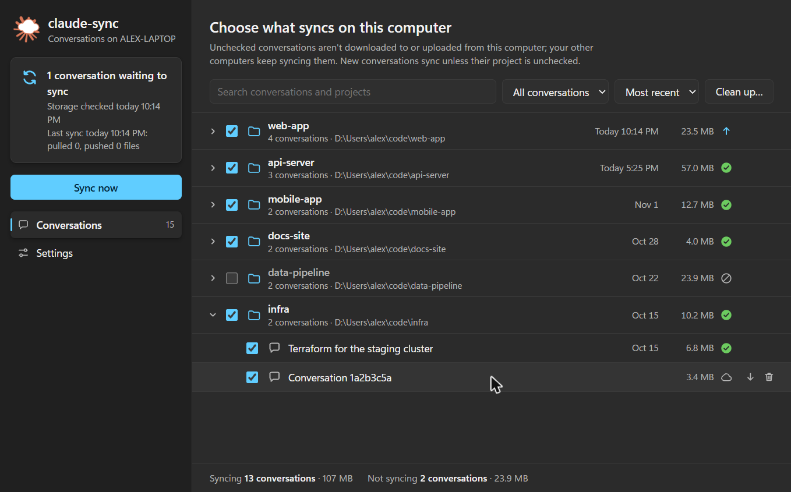
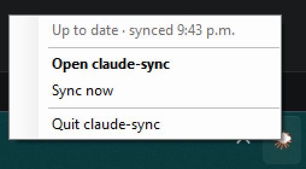
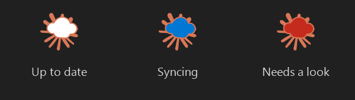
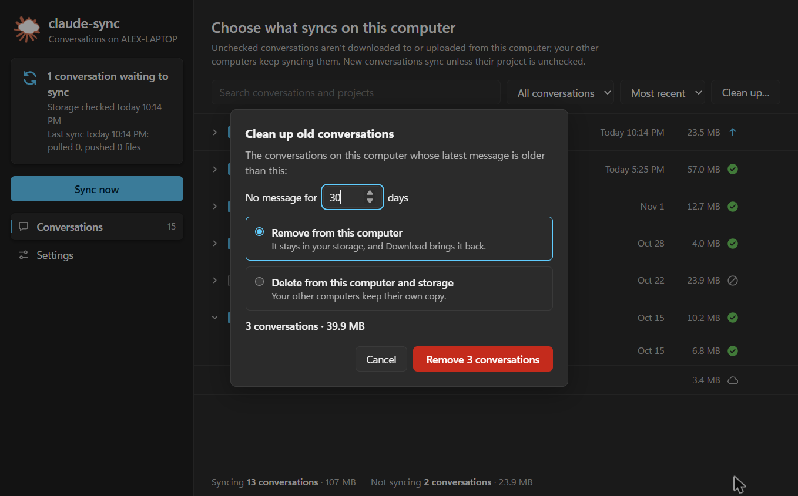
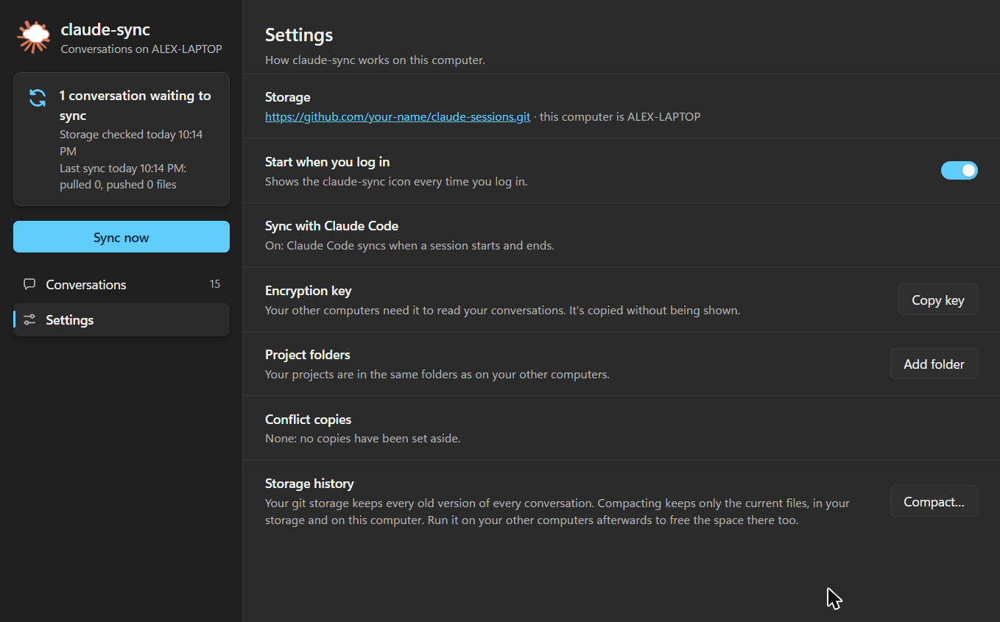

# Dashboard and notification area icon

claude-sync can work like a desktop sync app. An icon in the notification area (the menu bar on macOS) shows when a sync runs, and a dashboard lets you choose which conversations sync on each machine, clean up old ones and change settings without the terminal.

It runs on **Windows, macOS and Linux**, and needs nothing beyond claude-sync: PowerShell draws the icon on Windows, `osascript` on macOS, and `python3` on Linux. It's optional: the hooks keep syncing whether the icon runs or not.



## The icon



It shows how things stand at a glance, including syncs Claude Code starts when a session opens or closes:



Click it to open the dashboard. Its menu shows the status, **Sync now** and **Quit**.

## Choose what syncs

Every project and conversation on this machine or in your storage, with its latest message, size and state: up to date, waiting to upload or download, only in storage, or not syncing here.

- Uncheck a conversation, or a whole project, to keep it off this machine. Your other machines keep syncing it.
- New conversations sync unless their project is unchecked.
- A conversation that's only in storage, for example one Claude Code cleaned up after 30 days, has a **Download** button.

## Clean up



Delete one conversation from its row, or every conversation with no message for a number of days, in one of two ways:

- **Remove from this computer** frees the space here. The conversation stays in your storage, and **Download** brings it back.
- **Delete from this computer and storage** removes it from both. Your other machines keep their own copy.

## Settings



- **Storage**: a link to your repository or bucket.
- **Start when you log in**: the icon at every login.
- **Sync with Claude Code**: whether the hooks are installed and still work, with **Repair** if not.
- **Encryption key**: copied for your other machine, never shown on screen.
- **Project folders**: [folder mappings](../README.md#restoring-into-the-right-project) between machines.
- **Conflict copies**: copies set aside when two machines changed the same file.
- **Storage history** (git): **Compact** keeps only the current version of each file, since a git repository otherwise keeps every version ever pushed.

## Get it

With claude-sync [installed and set up](../README.md#quick-start):

```bash
claude-sync install --tray   # hooks, plus the icon, started at every login
claude-sync dashboard        # or only the dashboard, in your browser
```

Or, from a copy of this repository, double-click the installer for your system. It builds and installs claude-sync, asks for your storage (and your key, on another machine), syncs, and sets up the hooks and the icon:

| Windows | macOS | Linux |
|---------|-------|-------|
| `install-windows.cmd` | `install-macos.command` | `./install-linux.sh` |

The first time, your system may warn about a script from the internet: on Windows choose **More info → Run anyway**, on macOS allow it in **System Settings → Privacy & Security**.

## Good to know

- The dashboard is served on `127.0.0.1` only, behind a one-time link, so other websites and other users can't reach it. It opens in a window of its own when Chrome, Edge, Chromium or Brave is installed.
- On Linux the icon needs GTK and Ayatana AppIndicator for `python3` (`sudo apt install gir1.2-ayatanaappindicator3-0.1` on Debian and Ubuntu); GNOME also needs the AppIndicator extension. macOS needs version 11 or later.
- On Windows 11 a new icon starts in the hidden overflow (^): drag it onto the taskbar to keep it in sight.
- Problems are logged to `~/.claude-sync/tray/tray.log`. `claude-sync tray --no-startup` stops the icon starting at login.
- The icon is drawn from `assets/tray-icon.svg`. After changing it, run `powershell -NoProfile -ExecutionPolicy Bypass -STA -File scripts/render-tray-icons.ps1` on Windows to regenerate `src/tray/icons.ts`.
